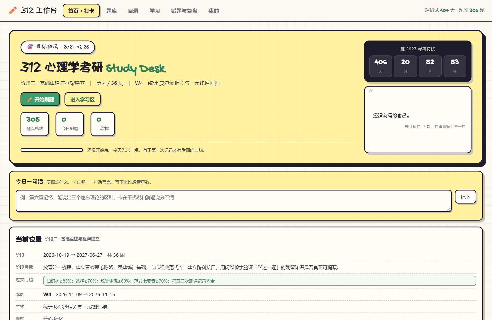
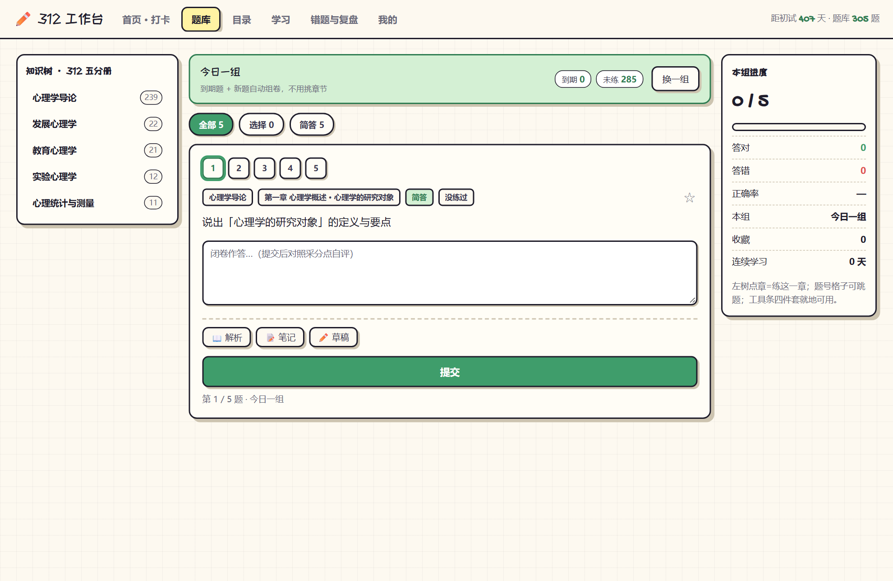
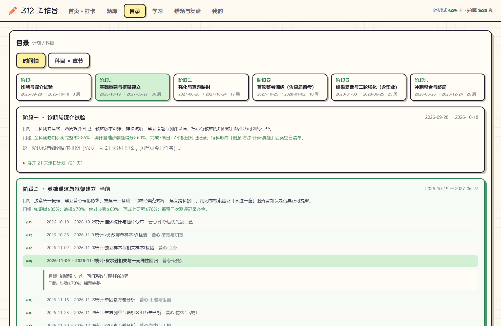
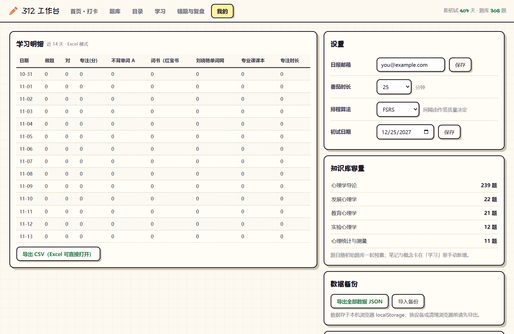

# 312 学习工作台

**给心理学考研（312）用的个人学习台。** 打卡、刷题、间隔复习、错题复盘、知识图谱，一套东西管完。

数据全部存在浏览器本地，不联网也能用，不需要注册、不需要后端。



---

## 为什么做这个

考研备考的麻烦不在「学不会」，在「不知道自己学到哪了」。

用纸质计划表会遇到三个问题：昨天背的东西今天忘了多少，说不清；某一章到底练没练透，说不清；离考试还有多少天、这周该干什么，得自己算。

这个工作台把这三件事落成可查的数字。它不替你学，只负责让你每天打开就知道下一步做什么。

---

## 能做什么

| | |
|---|---|
| **每日打卡** | 自定义打卡项（单词、真题、背诵…），带目标值和进度；支持从计划模板一键生成 |
| **间隔复习** | 基于 FSRS 算法排程，每天自动算出该复习哪些题，不用自己安排 |
| **今日一组** | 按记忆曲线挑「到期复习 + 没练过」的题凑成一组，不用挑章节 |
| **分点自评** | 简答题提交后列出采分点，自己勾答到了哪几点，按比例算掌握度——比机器瞎猜准得多 |
| **知识图谱** | 5 分册 / 36 章 / 541 个知识节点的树状目录，用 jsMind 渲染成思维导图 |
| **错题与复盘** | 做错的、标记存疑的题单独归集，可重练 |
| **五分册进度** | 每个分册的熟练度进度条，一眼看出哪块拖后腿 |
| **番茄钟** | 25 分钟专注计时，结束自动计入当日打卡 |
| **数据备份** | 一键导出 JSON，换电脑导入就恢复 |

---

## 快速开始

```bash
git clone https://github.com/origin-july/312-study-workbench.git
cd 312-study-workbench
python3 -m http.server 8779
# 浏览器打开 http://127.0.0.1:8779
```

**必须起本地服务，不能双击 `index.html`。** 题库是独立的 JSON 文件，靠 `fetch` 读取，浏览器会拦截 `file://` 协议下的这类请求。

Chrome / Edge / Firefox 都行。微信和 QQ 的内置浏览器打不开。

### 自测

打开 `http://127.0.0.1:8779/?selftest=1`，44 项断言的结果会写进页面标题。

命令行门禁（20 项：语法、按钮绑定、数据一致性、题目 id 稳定性、六页渲染、UI 逻辑回归）：

```bash
python3 tools/qa.py
```

显示「门禁通过」才算没弄坏。

源码仓库里会有两条「未找到单文件版」的警告 —— 那是原交付包的打包产物，开源版不做单文件构建，忽略即可。

---

## 界面

六个页面，顶栏切换。

### 首页 · 打卡

顶部是目标日期倒计时和当前阶段，中间是今日打卡项和番茄钟，下面是待办和五分册进度。



### 题库

三栏门户：左侧分册章节，中间题目，右侧答题区。顶部「今日一组」直接开练。

### 目录

两条视图：时间轴（哪周该学什么）和科目 × 章节矩阵（每章练了多少、掌握到什么程度）。



### 学习

自己写笔记、概念卡，看章节思维导图。

### 错题与复盘

做错的题和标记存疑的题，按知识点归类。

### 我的

初试日期、日报邮箱、推送配置、自己的留言板、数据导入导出。



---

## 掌握度是怎么算的

两道判断，分别回答不同的问题。

### 「这道题记住了吗」—— FSRS

[FSRS](https://github.com/open-spaced-repetition/ts-fsrs)（Free Spaced Repetition Scheduler）是 Anki 现行算法。每次作答后按答对/答错调整这道题的「稳定性」和「难度」，据此算出下次该在什么时候复习。

用的库是 `vendor/ts-fsrs.umd.js`，纯前端，不联网。降级路径：如果库没加载成功，自动退回 SM-2 简化版，功能不中断。

### 「这个知识点掌握了吗」—— 采分点自评

简答题是机器判不了的。这道题的解法是：题目自带采分点列表，提交后你自己勾选答到了哪几点，按命中比例给出这一题的正确率，再喂给 FSRS。

不追求「AI 判卷」那种看起来高级但实际不准的东西。**自己勾选 + 立刻看到采分点**，复盘价值比机器打分更高。

### 「已掌握」的门槛

间隔达到 **21 天以上**的题才算掌握。

这个数字不好刷——它奖励的是「记得住」，不是「刷得多」。刷一天就想全绿是做不到的，符合记忆规律。

---

## 数据存哪

全部在 `localStorage`，按**文件路径**隔离。

这意味着两件事：

1. **别改文件夹名，也别把 HTML 单独挪走。** 路径一变，之前的打卡和答题就找不回来了
2. 想备份就复制**整个文件夹**，或者用「我的 → 导出备份」存 JSON

没有后端、没有账号、没有云同步。你的学习记录不会离开这台电脑。

---

## 技术选择

| 选择 | 原因 |
|---|---|
| **纯前端，无构建** | 改完刷新就生效，不需要 `npm run dev` 等编译 |
| **原生 JS，无框架** | 六页状态机 + 局部重渲染，框架带来的复杂度大于收益 |
| **JSON 独立成文件** | 题库 305 题、目录 541 节点，放 JS 里会让 diff 无法阅读 |
| **CSP 白名单** | `index.html` 里写死了允许连接的域名（钉钉、企业微信、飞书、PushPlus、Bark），其余一律拦截 |

关于 CSP：如果你想接别的推送渠道，得在 `index.html` 的 `connect-src` 里加上对应域名，否则会被浏览器拦掉。

---

## 文件结构

```
index.html               入口，六页骨架 + CSP 声明
app.js                   全部逻辑（存储、FSRS 排程、六个页面渲染）
style.css                样式（单文件，手写字体 + 米色底）
catalog.json             知识目录：5 分册 / 36 章 / 541 节点（树状）
seed.json                题库：305 题（含采分点、知识点标注）+ 初始档案
plan.json                学习计划：6 阶段 / 88 周段
surprises.json           阶段奖励（打卡里程碑解锁的小惊喜）
selftest.js              浏览器内自测，44 项断言
vendor/
  ts-fsrs.umd.js         FSRS 间隔重复算法
  jsmind.js              思维导图渲染
  jsmind.css
  jsmind.screenshot.js   导图导出为图片
tools/
  qa.py                  命令行门禁（20 项）
  stable_ids.py          题目 id 稳定性校验
  render_smoke.js        六页渲染冒烟测试
  ui_regress.js          交互回归
docs/screenshots/        README 用截图
```

---

## 现在的数据规模

| 项目 | 数量 |
|---|---|
| 题库 | 305 题（285 简答 / 20 论述） |
| 知识目录 | 5 分册 / 36 章 / 541 节点 |
| 学习计划 | 6 阶段 / 88 周段 |

**已知缺口**：305 题全是主观题，**一道选择题都没有**。而 312 统考选择题占 120 分。这块还没补 —— 欢迎 PR。

---

## 路线图

- [ ] 补选择题题型（统考占 120 分，是目前最大的缺口）
- [ ] 题库支持导入外部 JSON，不必改代码
- [ ] 学习时长统计与周报
- [ ] 多科目支持（现在写死了 312，改成配置化就能用于其他考试）

---

## 参与

欢迎提需求、报 bug、补题、改文案。

```bash
git checkout -b feat/你的功能名
python3 tools/qa.py        # 必须「门禁通过」
git commit -m "feat(scope): 一句话说清改了什么"
```

提交信息用 Conventional Commits。详细约定见 [CONTRIBUTING.md](CONTRIBUTING.md)。

**特别欢迎**：往 `seed.json` 里补选择题。格式照现有题目的结构写，加 `type: "single"` 或 `"multi"`，附上 `keys`（正确答案）和 `src`（解析）。

---

## 许可与致谢

代码 [MIT](LICENSE)。

题目内容基于心理学考研通用教材整理，供个人学习使用。如果涉及版权问题请联系删除。

第三方库：
- [ts-fsrs](https://github.com/open-spaced-repetition/ts-fsrs) — MIT
- [jsMind](https://github.com/hizzgdev/jsmind) — BSD-2-Clause
